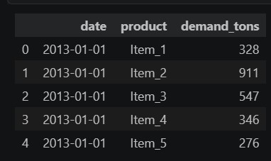
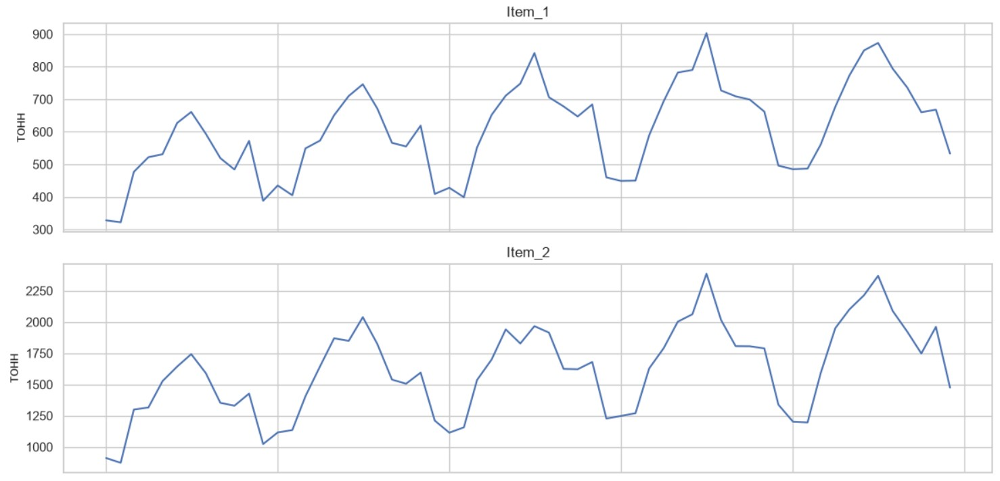
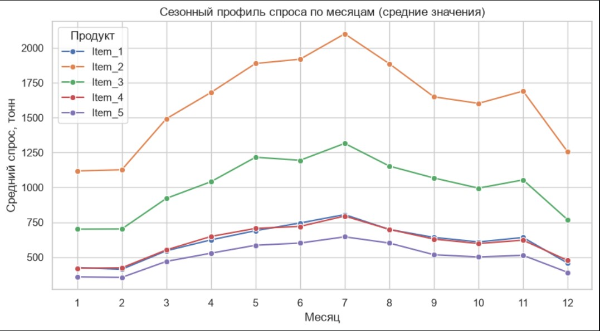
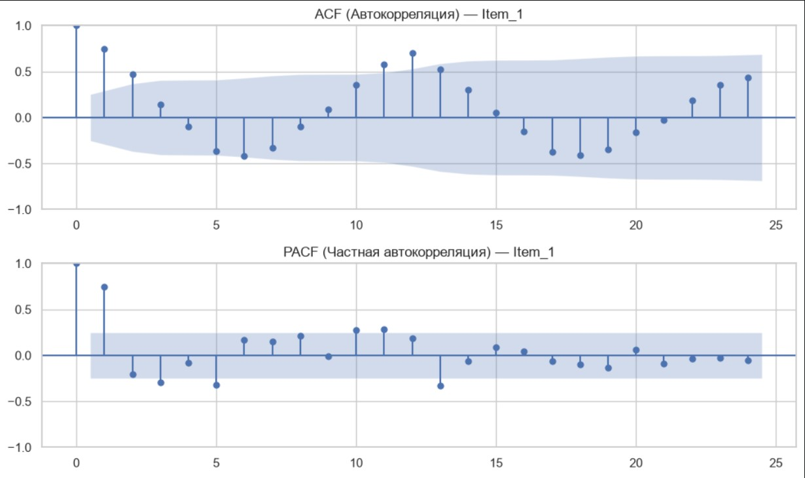
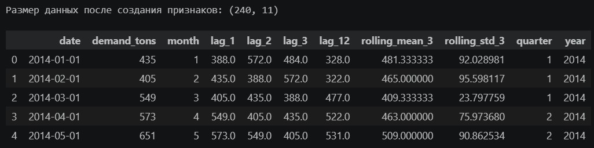
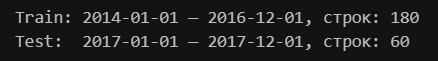
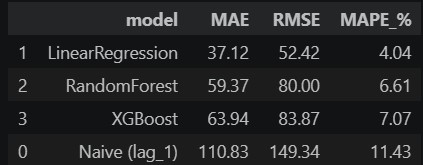
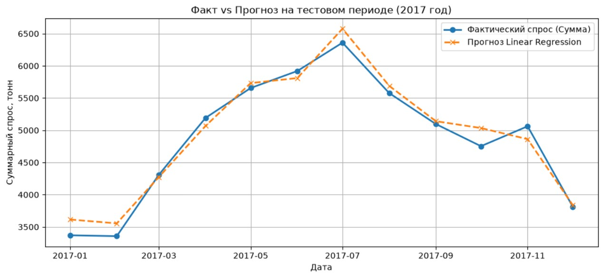
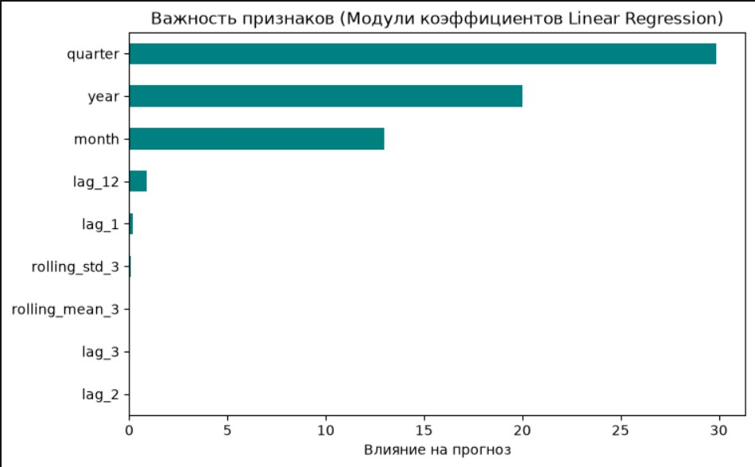
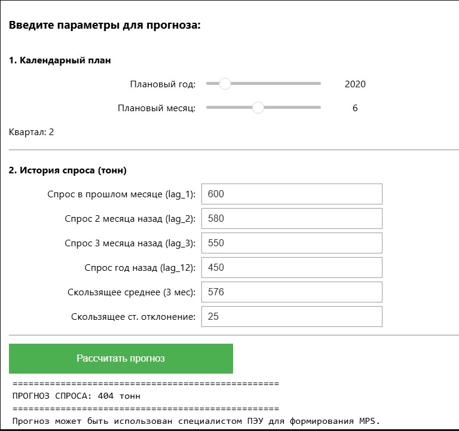

# Прототип ML-модели прогнозирования спроса для БП «Формирование MPS» (АО «СЛПК»)

## Описание задачи
В рамках ИКР разработан прототип модели машинного обучения для прогнозирования спроса на продукцию. Модель встраивается в бизнес-процесс формирования объёмно-календарного производственного плана (MPS) на этапе подготовки данных для специалистов ПЭУ.

## Данные
Использован открытый датасет Kaggle (Store Item Demand Forecasting), агрегированный до месячного уровня по 5 товарным группам. В качестве допущения данные адаптированы под контекст предприятия.

## Методика и результаты
1. **EDA**: Выявлена годовая сезонность (пик в июле) и тренд.
2. **Feature Engineering**: Созданы лаги (1, 2, 3, 12 месяцев), скользящие средние и календарные признаки.
3. **Моделирование**: Сравнены Naive, Linear Regression, Random Forest и XGBoost.
4. **Лучшая модель**: Linear Regression (MAPE = 4.04%). Модель хорошо улавливает тренд и не переобучается на малом объеме данных.

## Структура проекта
- `notebooks/` — ноутбуки с кодом
- `models/` — сохраненная модель (`best_demand_model.pkl`)
- `data/` — исходные и обработанные данные

## Как запустить
1. Установите зависимости: `pip install -r requirements.txt`
2. Ноутбуки запускаются через VS Code Jupyter.
3. Интерактивный интерфейс находится в `notebooks/04_interface.ipynb`.

# Краткое описание работы.

## 1. Подготовка данных
На этом этапе сырые данные были агрегированы до месячного уровня и исследованы на предмет закономерностей.

Фрагмент подготовленного датасета:

Первые строки подготовленного датасета. Данные приведены к нужному виду: дата, название продукта и объем спроса.

Графики временных рядов:

Графики спроса на разные товары за 5 лет. Видно, что спрос колеблется из года в год, но есть общий рост.

Сезонный профиль спроса:

Из сезонного профиля можно сделать вывод, что пик продаж приходится на середину лета, а зимой спрос падает.

Автокорреляция (ACF и PACF):

Графики автокорреляции. Они показывают, что текущий спрос сильно зависит от того, что было продано в прошлые месяцы и год назад.

## 2. Создание признаков
На основе выводов EDA были сгенерированы новые переменные для обучения моделей.

Результат генерации признаков:

Таблица с новыми признаками для модели. Добавлены данные о спросе за прошлые месяцы (лаги), скользящие средние и признаки календаря.

Хронологическое разделение данных:

Разделение данных на обучение и тест. Тестом стал последний 2017 год, чтобы модель не подсматривала в будущее.

## 3. Моделирование и оценка
Были протестированы различные алгоритмы — от простого Baseline до градиентного бустинга.

Сравнение метрик качества:

Таблица сравнения моделей. Неожиданно, но простая линейная регрессия обошла сложные модели (XGBoost, Random Forest) с ошибкой всего 4%.

Визуализация прогноза:

Сравнение реального спроса и прогноза на 2017 год. Модель хорошо поймала летний пик и общий тренд.

Важность признаков:

Видно, что модель в основном ориентируется на время года (квартал, месяц) и год.

## 4. Интерактивный интерфейс
Для демонстрации работы модели был разработан простой интерфейс.

Демонстрация работы модели:
Ниже приведён интерфейс, в котором можно рассчитать прогноз спроса на нужный месяц. Для этого нужно задать плановый год, месяц и ввести данные о прошлых продажах.
